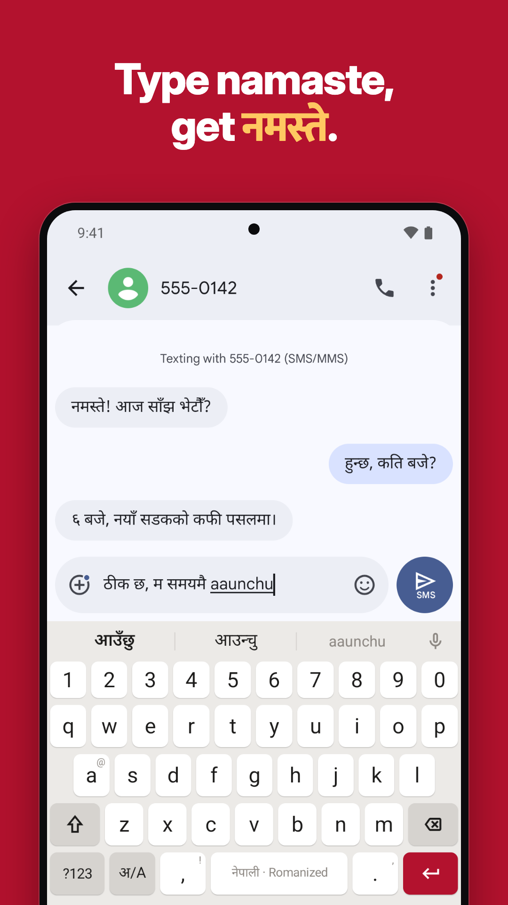
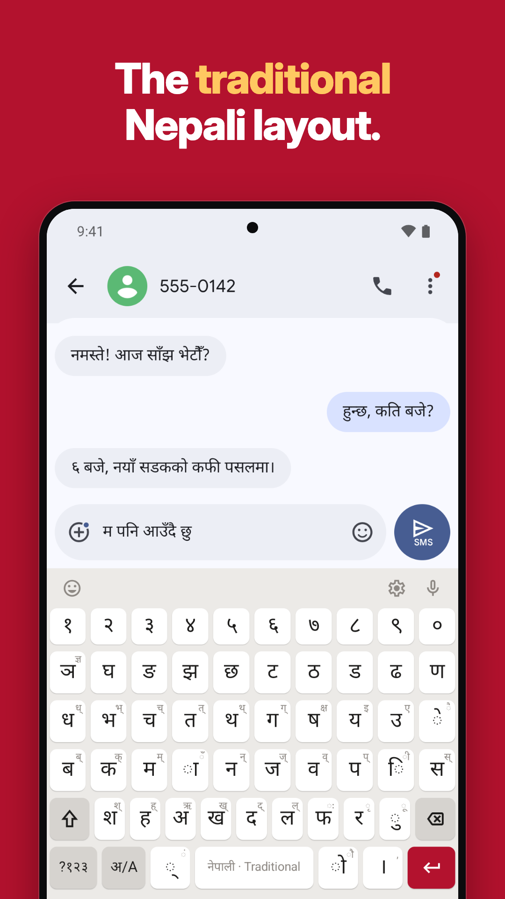
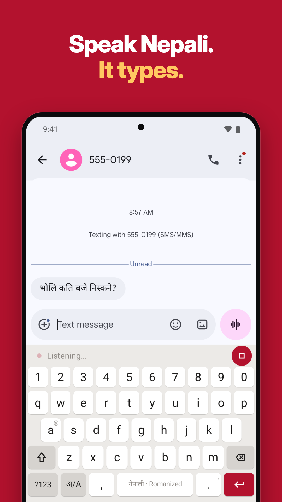
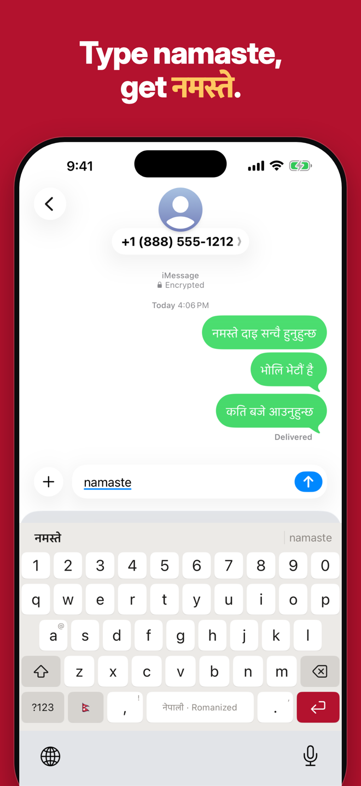
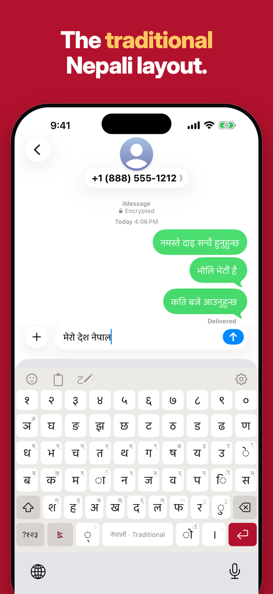
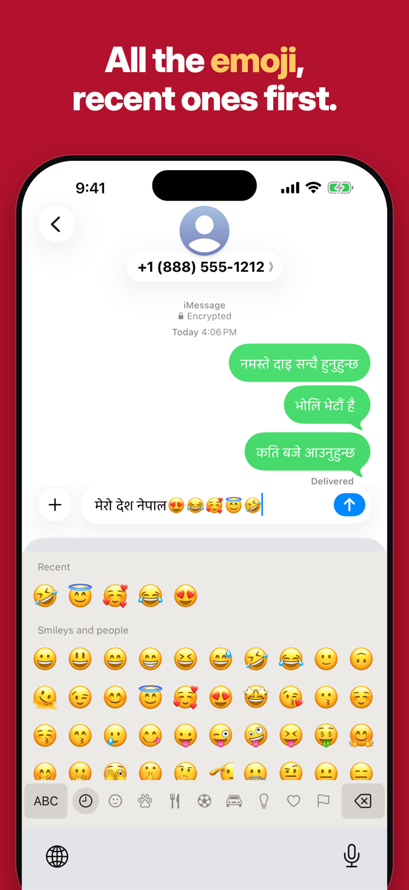

# Nepali Unicode Keyboard

A keyboard for typing Nepali in Unicode, in any app. It's on Google Play for Android and on the App Store for iPhone and iPad. It runs offline and doesn't send or store what you type.

<p>
  <a href="https://play.google.com/store/apps/details?id=io.github.thegbguy.nepalikeyboard"></a>
  <a href="https://apps.apple.com/us/app/nepali-unicode-keyboard/id6831912584"></a>
</p>

**Android**

<p>
  
  
  
</p>

**iPhone**

<p>
  
  
  
</p>

## Features

- **Romanized typing.** Type `namaste` and get नमस्ते. Suggestions come from a built-in Nepali word list. Half letters, ञ and the eyelash ra (र्‍य) can be typed directly, and a typing guide in the app shows what to type for each letter.
- **Traditional layout.** Nepali Unicode (traditional) with long-press shift characters.
- **Smart suggestions.** Bikram Sambat dates (`aaja`, `bholi`, `2026-10-21`), amounts in Nepali digits and words, and land/gold units (aana, ropani, tola).
- **Handwriting** with ML Kit Digital Ink, opt-in.
- **Voice typing** (Android) through the phone's speech service.
- **Physical keyboards** (Android). Romanized typing goes through the same engine; traditional typing uses the standard Windows Nepali layout. Ctrl + Space switches the language, and the screen shows just the suggestion strip, with a button to bring up the keys.
- **Accessibility.** Works with TalkBack and VoiceOver: keys read their character (vowel signs and marks by name, e.g. "आ vowel sign", "Halanta"; Devanagari is spoken with a Hindi voice where no Nepali one is installed), the language key reads the current mode, and long-press actions are in the actions menu.
- **Themes.** Nine keyboard themes (System, Light, Dark, Himalaya, Lali Gurans, Terai, Midnight, Dusk, Paper), with an option for flat keys without borders.
- A flag on the language key (🇳🇵 / 🇬🇧) shows which language you're typing. Emoji, clipboard history, English and Nepali app UI.
- **Privacy.** Nothing you type leaves the phone. On Android, password fields get plain English with no suggestions or voice; on iOS, the system switches to Apple's keyboard.

## Platforms

- **Android 7.0 or newer.**
- **iOS 17 or newer** (iPhone and iPad). No voice typing, because iOS doesn't let keyboards use the microphone, and no physical keyboard support, because iOS doesn't pass hardware key presses to third-party keyboards.

On iOS, clipboard history and handwriting need **Allow Full Access** (iOS hides the pasteboard from keyboards without it, and handwriting downloads its model). Both are opt-in, and everything else works with Full Access off. The history stays on the phone and can be cleared from the app. The keyboard reads the pasteboard only when you tap Paste or open the clipboard panel, because reading a copy from another app makes iOS ask "Allow Paste".

## Building

Requirements: Android Studio (or the Gradle wrapper) and JDK 17.

```sh
./gradlew :app:assembleDebug     # debug APK, no signing setup needed
./gradlew :app:testDebugUnitTest :shared:testAndroidHostTest # unit tests
./gradlew :shared:iosSimulatorArm64Test # shared tests on the iOS simulator (macOS only)
```

Release builds need an upload key. Copy `keystore.properties.example` to `keystore.properties` and fill it in, or set `PLAY_STORE_STORE_FILE`, `PLAY_STORE_STORE_PASSWORD`, `PLAY_STORE_KEY_ALIAS` and `PLAY_STORE_KEY_PASSWORD`.

### Romanized accuracy

`RomanizedBenchmarkTest` (part of the unit tests) types every row of `app/src/test/resources/romanized_corpus.tsv`, 355 Romanized words with the Nepali they should give, and fails if accuracy drops below 91% for the word space commits or 95% for the top three suggestions. It writes a report per category and every miss to the test's output (`app/build/test-results/testDebugUnitTest/`). Run it after any change to the transliteration engine or the word list, and raise the floors in the test when your change improves them.

```sh
./gradlew :app:testDebugUnitTest --tests '*RomanizedBenchmarkTest'
```

### iOS

The iOS app (one screen with setup steps, settings and a try-it field, plus the keyboard extension) is in `iosApp/`. Open `iosApp/NepaliKeyboard.xcodeproj` in Xcode 26 and run the `NepaliKeyboard` scheme; a build phase runs Gradle to build the shared Kotlin framework, so JDK 17 is needed here too. The project is generated from `iosApp/project.yml` with [XcodeGen](https://github.com/yonaskolb/XcodeGen): after editing that file, run `xcodegen generate` in `iosApp/`. New Swift files need no regeneration.

Handwriting uses Google ML Kit through [google-mlkit-swiftpm](https://github.com/d-date/google-mlkit-swiftpm), pinned in `project.yml`. Swift packages can't carry resource bundles, so ML Kit's `MLKitDigitalInkRecognition_resource.bundle` is checked in under `iosApp/Vendor/`. Xcode's first package resolve downloads a few hundred MB of ML Kit binaries.

```sh
xcodebuild -project iosApp/NepaliKeyboard.xcodeproj -scheme NepaliKeyboard \
  -destination 'generic/platform=iOS Simulator' CODE_SIGNING_ALLOWED=NO build
```

## Project layout

| Path | What's there |
| --- | --- |
| `app/src/main/java/.../service` | `InputMethodService` entry point |
| `shared/src/commonMain` | `KeyboardController` (what every key, panel and suggestion does), transliteration engine, calendar, numbers, units, smart suggestions, clipboard history, key layouts (Kotlin Multiplatform, shared with iOS, unit-tested) |
| `app/src/main/java/.../domain`, `.../data` | Android-only parts: field types from `EditorInfo`, word list loading, voice, handwriting, clipboard |
| `app/src/main/java/.../ui` | Compose keyboard (drawing `KeyboardController`'s state; `InputConnectionEditor` connects it to the field), setup and settings screens |
| `app/src/main/assets` | Word list and emoji data (the iOS keyboard bundles the same word list) |
| `iosApp/App`, `iosApp/Keyboard` | iOS setup app and keyboard extension (SwiftUI over `KeyboardController`; `ProxyEditor` connects it to the field) |
| `iosApp/Shared` | Settings keys and the clipboard history file used by both iOS targets. The app writes them to the App Group `group.io.github.thegbguy.nepalikeyboard`; the keyboard can only read the group without Full Access, so it keeps what it changes itself in its own defaults |
| `tools/wordlist`, `tools/emoji` | Scripts that regenerate the assets |
| `fastlane/metadata` | Play listing text, changelogs and screenshots (English and Nepali) |

To add or fix a word, edit `tools/wordlist/colloquial_ne.tsv` and rebuild the list as described in [tools/wordlist/README.md](tools/wordlist/README.md).

## Privacy

The keyboard collects no data. See the [privacy policy](https://nepali-indie-dev.github.io/nepali-keyboard/privacy-policy.html) and [terms of service](https://nepali-indie-dev.github.io/nepali-keyboard/terms-of-service.html).

## Contributing

Word reports, bug reports and pull requests are welcome. See [CONTRIBUTING.md](CONTRIBUTING.md) for how to report a wrong word, the pull request rules and commit sign-off. Report security or privacy problems privately as described in [SECURITY.md](SECURITY.md).

## License

The code is licensed under [GPL-3.0](LICENSE), with an extra permission to link with Google ML Kit and Play services. The word list is CC BY-SA 4.0 because it's derived from Nepali Wikipedia. [NOTICE](NOTICE) lists all third-party material.

The name "Nepali Unicode Keyboard" and the app icon aren't covered by the licence. If you publish a fork, use your own name, icon and application ID.
