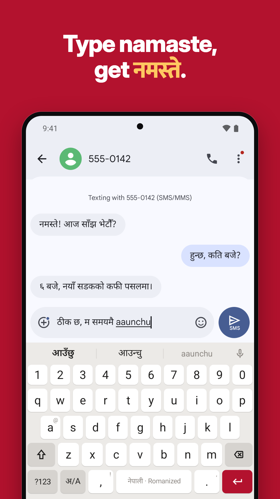
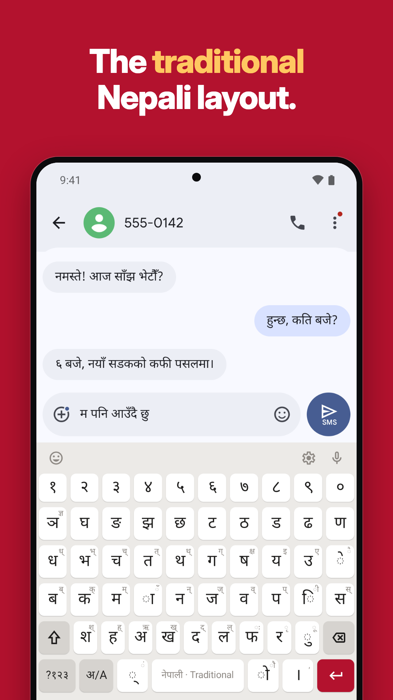
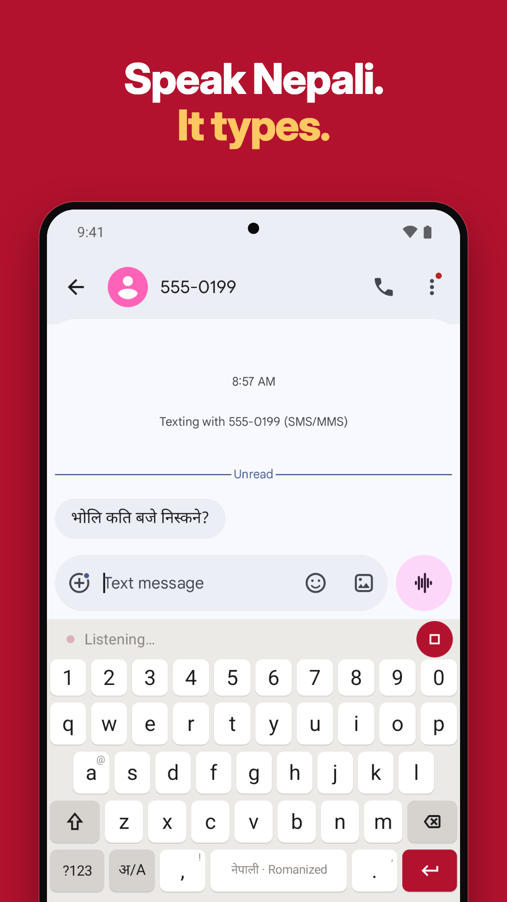

# Nepali Unicode Keyboard

An Android keyboard for typing Nepali in Unicode, in any app. It runs offline and doesn't send or store what you type.

<a href="https://play.google.com/store/apps/details?id=io.github.thegbguy.nepalikeyboard">Get it on Google Play</a>

<p>
  
  
  
</p>

## Features

- **Romanized typing.** Type `namaste` and get नमस्ते. Suggestions come from a built-in Nepali word list.
- **Traditional layout.** Nepali Unicode (traditional) with long-press shift characters.
- **Smart suggestions.** Bikram Sambat dates (`aaja`, `bholi`, `2026-10-21`), amounts in Nepali digits and words, and land/gold units (aana, ropani, tola).
- **Handwriting** (ML Kit Digital Ink, opt-in) and **voice typing** (the phone's speech service).
- Emoji, clipboard history, English and Nepali app UI, light and dark themes.
- **Privacy.** Password fields get plain English with no suggestions or voice. Nothing you type leaves the phone.

## Building

Requirements: Android Studio (or the Gradle wrapper) and JDK 17.

```sh
./gradlew :app:assembleDebug     # debug APK, no signing setup needed
./gradlew :app:testDebugUnitTest :shared:testAndroidHostTest # unit tests
./gradlew :shared:iosSimulatorArm64Test # shared tests on the iOS simulator (macOS only)
```

The iOS app (one screen with setup steps, settings and a try-it field, plus the keyboard extension) is in `iosApp/`. Open `iosApp/NepaliKeyboard.xcodeproj` in Xcode 26 and run the `NepaliKeyboard` scheme; a build phase runs Gradle to build the shared Kotlin framework, so JDK 17 is needed here too. The project is generated from `iosApp/project.yml` with [XcodeGen](https://github.com/yonaskolb/XcodeGen): after editing that file, run `xcodegen generate` in `iosApp/`. New Swift files need no regeneration.

On iOS, clipboard history is the only feature that needs **Allow Full Access** (iOS hides the pasteboard from keyboards without it). It's opt-in and everything else works with it off. The history is kept in the App Group (`clipboard.txt`), never leaves the phone, and can be cleared from the app. Reading a copy from another app makes iOS ask "Allow Paste" (Settings → Nepali Keyboard → Paste from Other Apps), so the keyboard reads the pasteboard only when you tap Paste or open the clipboard panel.

The iOS keyboard works with VoiceOver: keys read their character (Nepali vowel signs and marks by name, e.g. "आ vowel sign", "Halanta"), the language key reads the current mode, and what a long-press does (the corner character, the language menu, pinning or deleting a clipboard item) is in the Actions rotor.

```sh
xcodebuild -project iosApp/NepaliKeyboard.xcodeproj -scheme NepaliKeyboard \
  -destination 'generic/platform=iOS Simulator' CODE_SIGNING_ALLOWED=NO build
```

Release builds need an upload key. Copy `keystore.properties.example` to `keystore.properties` and fill it in, or set `PLAY_STORE_STORE_FILE`, `PLAY_STORE_STORE_PASSWORD`, `PLAY_STORE_KEY_ALIAS` and `PLAY_STORE_KEY_PASSWORD`.

## Project layout

| Path | What's there |
| --- | --- |
| `app/src/main/java/.../service` | `InputMethodService` entry point |
| `shared/src/commonMain` | `KeyboardController` (what every key, panel and suggestion does), transliteration engine, calendar, numbers, units, smart suggestions, clipboard history, key layouts (Kotlin Multiplatform, shared with iOS, unit-tested) |
| `app/src/main/java/.../domain`, `.../data` | Android-only parts: field types from `EditorInfo`, word list loading, voice, handwriting, clipboard |
| `app/src/main/java/.../ui` | Compose keyboard (drawing `KeyboardController`'s state; `InputConnectionEditor` connects it to the field), setup and settings screens |
| `app/src/main/assets` | Word list and emoji data (the iOS keyboard bundles the same word list) |
| `iosApp/App`, `iosApp/Keyboard` | iOS setup app and keyboard extension (SwiftUI over `KeyboardController`; `ProxyEditor` connects it to the field) |
| `iosApp/Shared` | Settings keys and the clipboard history file used by both iOS targets. The app writes them to the App Group `group.io.github.thegbguy.nepalikeyboard`; the keyboard can only read the group without Full Access, so it keeps what it changes itself in its own defaults |
| `tools/wordlist`, `tools/emoji` | Scripts that regenerate the assets |
| `fastlane/metadata` | Play listing text, changelogs and screenshots (English and Nepali) |

To add or fix a word, edit `tools/wordlist/colloquial_ne.tsv` and rebuild the list as described in [tools/wordlist/README.md](tools/wordlist/README.md).

## Privacy

The keyboard collects no data. See the [privacy policy](https://nepali-indie-dev.github.io/nepali-keyboard/privacy-policy.html) and [terms of service](https://nepali-indie-dev.github.io/nepali-keyboard/terms-of-service.html).

## Contributing

Word reports, bug reports and pull requests are welcome. See [CONTRIBUTING.md](CONTRIBUTING.md) for how to report a wrong word, the pull request rules and commit sign-off. Report security or privacy problems privately as described in [SECURITY.md](SECURITY.md).

## License

The code is licensed under [GPL-3.0](LICENSE), with an extra permission to link with Google ML Kit and Play services. The word list is CC BY-SA 4.0 because it's derived from Nepali Wikipedia. [NOTICE](NOTICE) lists all third-party material.

The name "Nepali Unicode Keyboard" and the app icon aren't covered by the licence. If you publish a fork, use your own name, icon and application ID.
